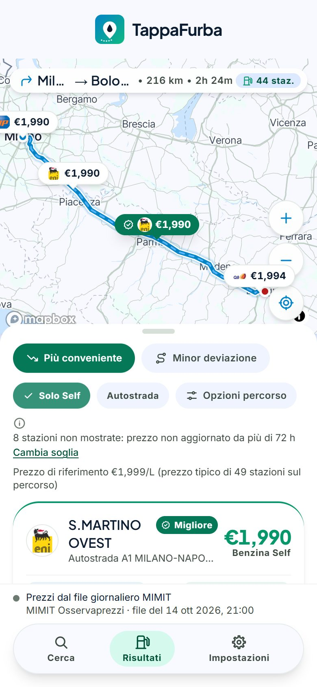
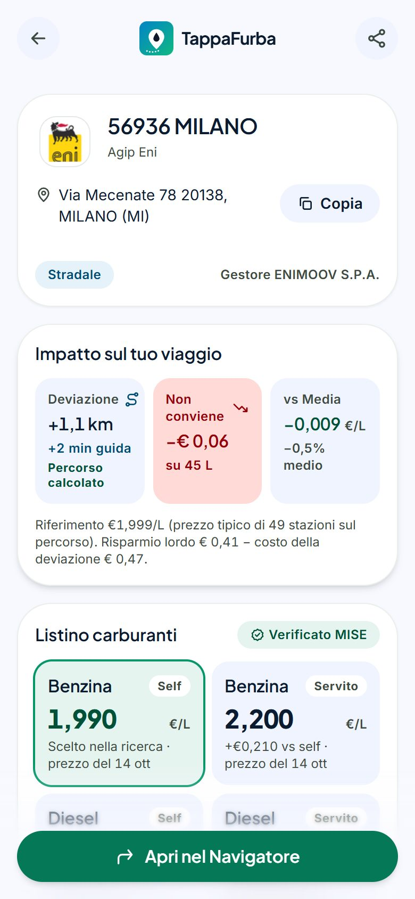

# TappaFurba


[](https://paypal.me/DavideDimo)

**Il carburante più conveniente lungo il tuo percorso, o intorno a te.**

TappaFurba è una web app (PWA) per chi guida in Italia. Inserisci partenza e arrivo: l'app cerca i distributori **lungo** il percorso (non in un raggio attorno a un punto) e li ordina per **risparmio netto**, cioè quanto risparmi sul prezzo meno quanto ti costa la deviazione in km e in minuti. Se invece sei già da qualche parte e devi solo fare il pieno, **«Intorno a me»** cerca attorno a un punto (la tua posizione o un indirizzo, fino a 10 km) con lo stesso calcolo, contando il giro completo andata e ritorno. I prezzi sono quelli ufficiali dell'Osservaprezzi Carburanti del MIMIT.

<p align="center">
  
  
  
  
</p>

## Come funziona

Per ogni distributore vicino al percorso l'app calcola:

```
risparmio netto = (prezzo di riferimento − prezzo del distributore) × litri da rifornire
                  − (km di deviazione × costo al km + minuti di deviazione × valore del tuo tempo)
```

- **Prezzo di riferimento:** il prezzo tipico dei distributori sul percorso (oppure un valore che scegli tu).
- **Litri, consumo, valore del tuo tempo:** li imposti una volta nelle Impostazioni e puoi cambiarli per singola ricerca.
- **Deviazione reale:** le prime stazioni della classifica sono verificate con il routing vero (Mapbox Directions); le altre hanno una stima geometrica, dichiarata come tale.
- **Self e Servito:** conta il prezzo self, a meno che tu non scelga «Solo Self»; se manca si usa il servito e lo si dice.

### Cosa c'è dentro

- Ricerca A→B con suggerimenti d'indirizzo, posizione attuale e tragitti frequenti (solo testi, salvati sul dispositivo).
- **«Intorno a me»:** il distributore più conveniente attorno a un punto (posizione attuale o indirizzo, raggio da 1 a 10 km), con lo stesso calcolo del risparmio sul giro andata e ritorno.
- Risultati con mappa (Mapbox GL), pin con prezzo e logo della bandiera, elenco ordinabile («più conveniente», «minor deviazione» o «più vicina») e opzioni di percorso (evita autostrade, pedaggi, traghetti).
- Dettaglio del distributore: impatto sul viaggio, listino per carburante e modalità, copia dell'indirizzo, condivisione e apertura nel navigatore (Apple Maps, Google Maps, Waze).
- Impostazioni: profilo veicolo, consumi (km/L o L/100 km), carburante predefinito, deviazione massima, valore del tempo, soglia di validità dei prezzi, tema della mappa.
- **Prezzi in tempo reale:** il file giornaliero MIMIT ha 1–2 giorni di ritardo; prima di ogni ricerca l'API aggiorna le zone attraversate dal percorso dal sito dell'Osservaprezzi (vedi le [note sulle fonti](docs/ATTRIBUTION.md#note-sulle-fonti)).
- **PWA:** installabile, la shell funziona offline; prezzi, ricerche e indirizzi non vengono mai messi in cache.

## Installazione in locale

### Prerequisiti

- **Node.js ≥ 24** e **pnpm ≥ 12** (la versione è indicata in `package.json`; con `corepack enable` viene scelta in automatico)
- **Docker** (per PostgreSQL + PostGIS in locale)
- Facoltativi: un token Mapbox lato server (senza, l'API usa geocoding di prova e percorsi rettilinei) e un token Mapbox pubblico per la mappa (senza, i Risultati mostrano solo l'elenco)

### Passi

```bash
# 1. Dipendenze
pnpm install

# 2. Variabili d'ambiente del backend (i valori di default bastano per partire)
cp apps/api/.env.example apps/api/.env

# 3. Database PostgreSQL + PostGIS (porta 5433 sull'host)
docker compose up -d

# 4. Schema del database (db/schema.sql: si può rilanciare senza danni)
pnpm db:migrate

# 5. Dati MIMIT reali: anagrafica e prezzi (circa 15 secondi, serve internet)
pnpm ingest

# 6. Backend (http://localhost:3001) e frontend (http://localhost:5173), in due terminali
pnpm dev:api
pnpm dev:web
```

Apri **http://localhost:5173** (usa `localhost`, non `127.0.0.1`: la CORS dell'API ammette solo `CORS_ORIGIN`).

### Mapbox

| Cosa | Dove | Note |
|---|---|---|
| `MAPBOX_SERVER_TOKEN` | `apps/api/.env` | Un token **dedicato al server**, senza restrizione URL: serve a Directions e Geocoding. Mai nel browser, mai in git. Se è vuoto l'API parte lo stesso con geocoding «fixture» (una decina di luoghi noti) e routing «mock» (rettilinei): la pipeline è identica, le deviazioni no. |
| `VITE_MAPBOX_PUBLIC_TOKEN` | `apps/web/.env` | Un token **pubblico** (`pk.…`) con restrizione URL (`http://localhost:5173/*` in locale, il tuo dominio in produzione). Senza, la mappa non compare. |

Gli stili della mappa (Light, Duotono, Carta Stradale, Monocromo) sono definiti in `apps/web/src/lib/mapStyle.ts` come stili di un account Mapbox Studio. Per usare i tuoi, sostituisci gli indirizzi `mapbox://styles/…` e le anteprime in `apps/web/public/styles`, oppure punta agli stili standard di Mapbox. Il token pubblico deve poter leggere gli stili.

**Costi:** Mapbox non ha un tetto di spesa nativo. L'API protegge il piano gratuito con limiti di richieste per IP e due tetti mensili globali sulle chiamate in uscita: Directions (`DIRECTIONS_SOFT_LIMIT` / `DIRECTIONS_HARD_LIMIT`) e Geocoding (`GEOCODING_HARD_LIMIT`); imposta anche un avviso di spesa nel pannello Mapbox.

### Provare l'API da riga di comando

Esempio Milano Centrale → Bologna Centrale (servono `curl` e `jq`):

```bash
RES=$(curl -s -X POST http://localhost:3001/search -H 'Content-Type: application/json' \
  -d '{"origin":{"lon":9.204,"lat":45.4864},"destination":{"lon":11.3426,"lat":44.5058},"fuelType":"benzina"}')
echo "$RES" | jq '.referencePrice, (.results | .[:5])'
sleep 4   # la verifica col routing reale continua in background
curl -s "http://localhost:3001/search/$(echo "$RES" | jq -r .searchId)" | jq .refinement
```

Stesso esempio per «Intorno a me» (un punto e un raggio in km, da 1 a 10):

```bash
curl -s -X POST http://localhost:3001/nearby -H 'Content-Type: application/json' \
  -d '{"origin":{"lon":9.204,"lat":45.4864},"radiusKm":5,"fuelType":"benzina"}' | jq '.referencePrice, (.results | .[:5])'
```

## Sviluppo

### Comandi

| Comando | Effetto |
|---|---|
| `pnpm dev:web` / `pnpm dev:api` | Frontend (Vite) / backend (Fastify con ricarica automatica) |
| `pnpm db:migrate` | Applica `db/schema.sql` al database di `DATABASE_URL` |
| `pnpm ingest` | Scarica i CSV MIMIT e aggiorna anagrafica e prezzi (idempotente) |
| `pnpm test` | Test unitari e di integrazione senza rete né database |
| `pnpm test:db` | Test su PostgreSQL/PostGIS reale (richiedono database con schema e dati ingeriti) |
| `pnpm test:e2e` | Test end-to-end Playwright (Chromium) |
| `pnpm typecheck` | Controllo dei tipi di tutti i pacchetti |
| `pnpm build` | Build di produzione del frontend |
| `pnpm --filter @tappafurba/web verify:pwa` | Verifica la build PWA (service worker, manifest, icone, dati mai in cache) |
| `pnpm --filter @tappafurba/web generate:icons` | Rigenera icone, favicon e immagine social da `assets/logo.svg` |
| `pnpm --filter @tappafurba/web fetch:brands` | Riscarica i loghi delle bandiere (a mano, vedi [ATTRIBUTION](docs/ATTRIBUTION.md)) |
| `pnpm --filter @tappafurba/api diagnose -- --station "NOME" --from "…" --to "…"` | Spiega perché una stazione compare (o no) in una ricerca; legge dal database, non scrive |

### Test

| Suite | Test | Richiede |
|---|---|---|
| `packages/core` | 170 | niente |
| `apps/api` | 336 | niente (provider di prova, repository in memoria) |
| `apps/web` | 771 | niente (la mappa WebGL è sostituita da uno stub in jsdom) |
| `pnpm test:db` | 33 | `docker compose up -d`, `pnpm db:migrate`, `pnpm ingest` |
| `pnpm test:e2e` | 19 | Chromium: `pnpm --filter @tappafurba/e2e exec playwright install chromium`, oppure `E2E_CHROME_CHANNEL=chrome` per usare il Chrome installato |

I test end-to-end usano solo `data-testid`. Avviano da soli un'API di prova (`apps/api/src/e2e`: luoghi noti, routing senza rete, stazioni fittizie in memoria) e la build di produzione del frontend: nessun database, nessuna chiave, nessuna chiamata esterna. La CI (`.github/workflows/ci.yml`) esegue test, typecheck, build, `verify:pwa` ed e2e.

### Struttura del repository

```
apps/
  web/        Frontend: React 18, Vite, Tailwind, Mapbox GL JS, PWA (vite-plugin-pwa)
  api/        Backend: Fastify 5, Kysely, PostgreSQL + PostGIS, ingestione MIMIT
  e2e/        Test end-to-end (Playwright)
packages/
  core/       Logica di dominio pura: CSV, normalizzazione, geometria, risparmio netto, ordinamento
  shared/     Tipi del contratto API condivisi da frontend e backend
db/           schema.sql: lo schema del database
docs/         ARCHITECTURE.md, ATTRIBUTION.md, screenshot
assets/       logo.svg, unica sorgente di icone e favicon
DESIGN.md     Design system (token di colore, tipografia, componenti): unica fonte dei token
```

Architettura, flussi dati e decisioni sono in [`docs/ARCHITECTURE.md`](docs/ARCHITECTURE.md).

### Variabili d'ambiente

| File (ignorato da git) | Template | Chi lo legge |
|---|---|---|
| `apps/api/.env` | `apps/api/.env.example` | API, ingestione e test sul database (`dotenv`, dalla cartella `apps/api`) |
| `apps/web/.env` | `apps/web/.env.example` | Vite: solo variabili `VITE_*`, lette all'avvio e **incluse nel bundle del browser** (mai metterci segreti) |

Ogni variabile è commentata nel rispettivo `.env.example`. Le più importanti in produzione: `DATABASE_URL`, `CORS_ORIGIN`, `TRUST_PROXY`, `MAPBOX_SERVER_TOKEN` (un token **segreto** `sk.`) (API); `VITE_API_BASE_URL`, `VITE_MAPBOX_PUBLIC_TOKEN`, `VITE_SITE_URL` (frontend, lette **in fase di build**).

### Risoluzione problemi

- **L'autocomplete dice «Suggerimenti non disponibili»:** quasi sempre CORS (stai usando `127.0.0.1` invece di `localhost`) o l'API non è avviata.
- **Ho cambiato una variabile e non succede nulla:** l'API legge `apps/api/.env` e Vite `apps/web/.env` solo all'avvio; riavvia `pnpm dev:api` / `pnpm dev:web`.
- **`autenticazione con password fallita per l'utente "tappafurba"`:** sulla 5432 c'è probabilmente un PostgreSQL nativo. Il container usa la **5433**: controlla `DATABASE_URL`.
- **«Mappa non disponibile»:** manca `VITE_MAPBOX_PUBLIC_TOKEN`, o il token non è autorizzato per `http://localhost:5173/`. L'elenco funziona comunque.
- **«Prezzi in tempo reale non raggiungibili»:** il sito dell'Osservaprezzi non ha risposto o ha risposto 429; l'API fa una pausa automatica e intanto usa il file giornaliero. Con `LIVE_PRICES_PROVIDER=off` si disattiva.
- **Una stazione che vedi sul sito del ministero non compare:** di solito è la soglia di validità dei prezzi (Impostazioni → Algoritmo & Filtri, di fabbrica 72 ore). Il comando `diagnose` mostra dove viene scartata.
- **`429 RATE_LIMITED`:** hai superato i limiti per IP (20 ricerche/minuto, 120 richieste di geocoding/minuto); si cambiano in `apps/api/.env`.
- **`503 BUDGET_EXHAUSTED`:** un contatore mensile (tabella `api_usage`) ha raggiunto il suo tetto: `DIRECTIONS_HARD_LIMIT` per le ricerche, `GEOCODING_HARD_LIMIT` per i suggerimenti d'indirizzo (in quel caso l'app mostra «Suggerimenti non disponibili»).

## Deploy in produzione

In produzione servono:

- **PostgreSQL + PostGIS**, con lo schema di `db/schema.sql` applicato (`pnpm db:migrate`);
- **il servizio API** (`pnpm --filter @tappafurba/api start`, TypeScript eseguito con `tsx`) dietro un reverse proxy con TLS, con `TRUST_PROXY=1` (il **numero** di proxy fidati: `true` si fida dell'intero header `X-Forwarded-For`, falsificabile, e permette di aggirare il rate limit), con un proxy che **sovrascrive** `X-Forwarded-For` con l'IP reale, `CORS_ORIGIN` uguale all'origine esatta del frontend e `POST /ingest` **non raggiungibile dall'esterno** (non ha autenticazione);
- **il frontend statico** (`pnpm build`, cartella `apps/web/dist`) servito con fallback a `index.html` per le rotte dell'app e `sw.js` senza cache HTTP; le variabili `VITE_*` si leggono in fase di build;
- **un'esecuzione periodica di `pnpm ingest`** (una volta al giorno) per aggiornare anagrafica e prezzi;
- **backup** del database (`api_usage` tiene i contatori mensili di Directions e Geocoding e non si ricostruisce dall'ingestione).

## Dati, marchi e crediti

I dati dei prezzi sono open data del MIMIT (licenza IODL 2.0); la mappa è di Mapbox con dati © OpenStreetMap; i loghi delle bandiere sono marchi dei rispettivi titolari. Dettagli e obblighi di attribuzione in [`docs/ATTRIBUTION.md`](docs/ATTRIBUTION.md).

## Sostieni il progetto

Se TappaFurba ti è utile puoi sostenerne lo sviluppo con una donazione. Grazie!

[](https://paypal.me/DavideDimo)

## Licenza

Il codice è rilasciato con licenza [Apache-2.0](LICENSE) (© 2026 Davide Dimo, vedi [`NOTICE`](NOTICE)).

La licenza riguarda il **codice**. Non concede diritti sul nome «TappaFurba», sul marchio grafico (`assets/logo.svg` e le icone derivate), sui loghi dei distributori in `apps/web/public/brands` (marchi dei rispettivi titolari) né sugli stili e sulle anteprime delle mappe Mapbox: vedi [`docs/ATTRIBUTION.md`](docs/ATTRIBUTION.md).
